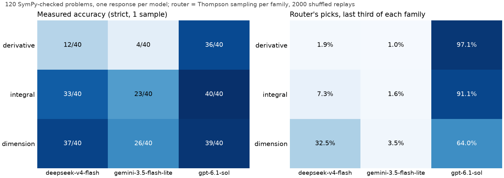

# verified-model-router

**A Thompson-sampling router that sends calculus and dimensional-analysis problems to one of three LLMs, rewarded only by a SymPy verifier.** The question was whether models are "spiky" enough, meaning much stronger in some domains than others, for a per-domain router to beat the best single model.

**On these problems, they are not.** One model was best in every family. The per-family router lost 7.2 points to simply using that model, because with no specialization to exploit, exploration is pure cost. The variation that does exist is in **cost**: the cheap model nearly matches the best one on dimensional analysis at about a sixth of the price per problem. Its failures are mostly running out of output tokens, not wrong mathematics.



*Left: correct answers out of 40 per family, scored strictly, with one response per model per problem. Right: the share of the router's picks in the last third of each family's problems, averaged over 2,000 shuffled replays.*

| policy (120 problems) | accuracy | 95% interval, bootstrap over problems | mean $ per problem |
|---|---|---|---|
| gpt-6.1-sol alone (best single model, in hindsight) | 95.8% | 92.5-99.2% | 0.00602 |
| deepseek-v4-flash alone | 68.3% | 61.7-75.0% | 0.00104 |
| gemini-3.5-flash-lite alone | 44.2% | 36.7-51.7% | 0.00588 |
| best model per family, in hindsight | 95.8% | 92.5-99.2% | 0.00602 |
| **Thompson sampling per family** (the router) | **88.6%** | 82.5-93.3% | 0.00534 |
| Thompson sampling with no family context | 92.5% | 85.8-96.7% | 0.00571 |
| uniform random | 69.4% | 61.7-77.5% | 0.00431 |
| per-problem oracle (any model correct) | 96.7% | 93.3-99.2% | 0.00369 |

All results and every table: [`results/summary.md`](results/summary.md). Raw numbers: [`results/metrics.json`](results/metrics.json).

## Limits, stated up front

- **Toy, checkable problems.** These are 120 generated problems with exact answers. Real physics reasoning has no ground truth to check against, and that gap is the point of the last section.
- **Three models, one sample each.** Temperature 0 was requested (reasoning endpoints may not honour it), but no repeated sampling was done, so model sampling noise is not measured. Every interval below comes from the problems or the router's own randomness, never from the models.
- **One reasoning setting.** Every model ran at `reasoning.effort=low` with a 16,000 output-token cap. Different settings would change the numbers, and DeepSeek's in particular (see Findings).
- **The verifier covers only checkable answers.** It cannot judge an argument, only a final expression. Dimension checks ignore numeric prefactors by design.
- **A bandit is far simpler than a learned orchestrator.** This is not comparable to Sakana's Fugu or to FirstPrinciples' Theo, and does not claim to be.

## Findings

1. **The models are not specialized here.** The test was fixed before the main run (`src/vmr/analysis.py`) and all three of its conditions fail. `gpt-6.1-sol` is the best model in every family, so the gain from routing each family to its best model, even with hindsight, is 0.0% (permutation p = 1.0). When the per-family best is chosen on one half of the problems and scored on the other, the mean gain is -0.9%. The two models below it are not complementary either: 4 problems were solved by no model, and 49 by all three.

2. **The router pays for exploring.** Per-family Thompson sampling reached 88.6% against 95.8% for the best single model. The paired difference is -7.2 points, with a 95% bootstrap interval of -11.7 to -3.3. With only 40 problems per family, each family's sampler has to rediscover the same winner on its own. The context-free sampler pools all 120 and reaches 92.5%. That comparison is a mean of -3.9 points, with an interval of -9.2 to +1.7 that includes zero, so it is suggestive only. The router did learn: in the last third of each family it picked `gpt-6.1-sol` 97.1% of the time for derivatives and 91.1% for integrals. On dimension problems it was still splitting, 64.0% versus 32.5% for DeepSeek, because 39/40 versus 37/40 is hard to tell apart from 40 samples.

3. **The variation that exists is in cost, and in token budgets, not in mathematical skill.**
   - **Cost.** `deepseek-v4-flash` costs $0.00104 per problem against $0.00602 for `gpt-6.1-sol`, and scores 37/40 against 39/40 on dimension problems.
   - **Truncation.** 31 of its 120 responses were cut off at the 16,000-token cap. 28 of those were derivative problems in tiers 2-3: 13 of 15 in tier 2 and all 15 in tier 3. When it produced an answer, 97.6% of its answers were correct.
   - **What that means.** Its weak derivative score is a token-budget effect at this setting, not evidence that it is bad at calculus.
   - **The oracle.** It reaches 96.7% at $0.00369 per problem, so a per-problem router has cost headroom but almost no accuracy headroom.
   - **List price misleads.** `gpt-6.1-sol` lists at $10 per million output tokens against $2.50 for Gemini, yet costs about the same per problem, because it averaged 558 completion tokens against Gemini's 2,324.

4. **Cost-aware routing trades accuracy for money, roughly along a straight line.** The cost-aware variant maximizes sampled accuracy minus mean cost divided by V, the dollar value of a correct answer. At V = $0.03 it reaches 82.1% at $0.00411 per problem, and at V = $0.10, 87.4% at $0.00508. It never beats picking `gpt-6.1-sol` outright, because nothing here is both cheap and better.

5. **A verifier at inference time beats a bandit, when one exists.** "Try the cheapest model, verify, escalate" reaches the oracle's 96.7%. Ordering by mean cost puts Gemini second, so this cascade costs $0.00752 per problem, more than `gpt-6.1-sol` alone. The order was not changed after seeing this. The structural point holds anyway: a bandit is for when the verdict arrives late or costs a lot, and for real physics reasoning, it does not arrive at all.

6. **A noisy verifier degrades routing gradually.** Flipping the router's reward at a rate of 10% / 20% / 30% / 40% (false accepts and false rejects at the same rate) lowers its true accuracy from 88.5% to 85.6% / 82.2% / 78.3% / 73.9%. This is a simulation on real responses, not a measurement of any real verifier. The 0% row comes from a separate replay, so it differs by 0.1 point from the 88.6% above.

7. **The strict format cost little.**
   - **Format failures.** Apart from DeepSeek's truncations, there were 11 across 360 responses: 4 `unparseable` and 7 `no_answer`.
   - **Lenient re-score.** Rescoring with lenient parsing (`^`, `ln`, `+ C`, markdown) changes total accuracy by under one point, the largest change being DeepSeek's 68.3% to 69.2%.
   - **The verifier itself.** It accepted none of 621 deliberately wrong answers, and rejected none of 610 equivalent rewrites, so both rates are at most 0.6% at 95% confidence. These injected cases are easier than real errors. A sample of 20 real verdicts is waiting for a hand check, which has not been done yet.

## Why this matters for evaluating AI physics reasoning

Every reward in this repo comes from a checker that knows the answer, or can test it (by differentiating an antiderivative, or comparing dimensions). That is also what Sakana's orchestrators train on: verifiable questions with ground truth. The harder problem, and FirstPrinciples' problem, is reasoning where no such checker exists: a derivation whose final expression is novel, or an argument with no single answer. Three parts of this repo bear on that:

- **What a weak signal costs.** The noise simulation measures how routing degrades as the reward gets worse.
- **Where verification is cheap, use it directly.** Verify-then-escalate makes the bandit unnecessary.
- **Partial checks have a structure to them.** Dimensions, limits, symmetries and special cases can each reject an answer without ever proving it right. The dimension family is a small example. It checks dimensions, but cannot see a wrong factor of 2π.

A next step that would matter to FirstPrinciples is a verifier that composes such partial checks, with a measured false-accept rate, used as the reward.

## What I would do next

- Repeat with several samples per problem at two reasoning levels, so model noise and budget effects can be measured, not assumed.
- Re-run DeepSeek with a larger token cap, to separate "cannot solve" from "ran out of budget".
- Add families where specialization is more plausible, such as long symbolic simplification versus numerical estimation, and use problem features rather than family labels as the context.
- Replace the ground-truth verifier with partial checks (dimensions, limits, special values), and measure how much routing quality survives.

## Running it

Requires [uv](https://docs.astral.sh/uv/) and Python 3.12. Dependencies are pinned in `uv.lock`.

```bash
make reproduce   # tests, then rebuilds every result from the committed raw responses, and checks they match. No API calls.
make mock        # the whole pipeline on synthetic responses, written to build/. Not a result.
make live        # paid: calls OpenRouter only for missing (problem, model) pairs. Needs OPENROUTER_API_KEY.
```

Total API spend, including smoke tests and the two calibration pilots, was $2.22, and the main run was $1.55 (`results/pilots.json`).

## How it works

**Problems** (`src/vmr/problems.py`, `data/problems.jsonl`). The set has 120 seeded problems, 40 per family, in tiers of 10, 15 and 15. The generator is deterministic, and `make reproduce` checks that it rebuilds the committed file byte for byte.

| family | tier 1 | tier 2 | tier 3 |
|---|---|---|---|
| derivative | third derivatives, and order 6-8 derivatives at 0 | order 9-11 derivatives at 0 of a 3-factor product | order 12-13 derivatives at 0 of a 4-factor product |
| integral | parts, partial fractions, x·atan, x²·sqrt(x²+a) | quartic and cubic denominators, log³, trig products | x⁵·e^ax·sin, ratios over quartics, log⁴, repeated cubes |
| dimension | the monomial in ħ, c, G, k_B, ε₀, μ₀, e with given dimensions | the same for one named quantity in a basis of five others (a 5×5 exact solve) | the same for a compound target, with all five exponents nonzero |

Ground truth comes from SymPy. Each integrand has a SymPy antiderivative that the generator checks by differentiating it back, but the verifier never needs that reference. High-order derivatives use truncated Taylor products, which are exact rationals.

**Answer format.** The final line must be `ANSWER: <expr>`, in Python syntax, using a fixed list of names. Model text is parsed by a whitelisted AST walker (`src/vmr/safe_parse.py`), never by `sympify`, because `sympify` uses `eval`. Anything outside the grammar is a format failure (`^`, `ln`, `+ C`, LaTeX, markdown around the line). Format failures are reported apart from wrong answers.

**Verifier** (`src/vmr/verifier.py`). It returns one of six statuses: `correct`, `wrong`, `unparseable`, `no_answer`, `truncated` (hit the token limit), and `inconclusive`.

- **Expressions and values:** evaluated at 8 seeded random points in the stated domain to 60 digits. One mismatch means wrong. A time-limited `simplify` proof is recorded when it succeeds.
- **Antiderivatives:** the answer is differentiated and compared with the integrand, so any constant of integration is fine.
- **Dimension answers:** exact rational exponent vectors from `sympy.physics.units`.

**Models** (`data/models.json`). Three vendors at three price tiers, picked from the live OpenRouter list on 2026-11-07. All three ran at `reasoning.effort=low`, with `temperature=0` requested, with up to 16,000 output tokens, once per problem. `data/raw/` holds every full response, with tokens and the cost OpenRouter reported.

**Router** (`src/vmr/bandit.py`). Thompson sampling with a Beta(1,1) prior for each (family, model). The verifier's verdict is the reward: 1 only for `correct`. The complete response matrix lets the bandit be replayed with no extra API calls, over 2,000 shuffled problem orders and over 2,000 bootstrap resamples of the problems. Arms the router did not pick are never shown to it.

**Baselines** (`src/vmr/analysis.py`):
- each model alone
- the best single model in hindsight
- the best model per family in hindsight, the ceiling for any per-family router
- uniform random routing
- a per-problem oracle
- Thompson sampling without the family context
- a cost-aware Thompson variant
- a verify-and-escalate cascade

**Calibration.** The difficulty was set on two separate pilot sets, never on the main set. The target was written down before the first pilot, and the models, prompt and verifier never changed. See [docs/calibration.md](docs/calibration.md) and `results/pilots.json`.

## Context: Sakana's orchestration work

This project came out of a conversation about routing LLM calls to models that are unusually strong in particular domains. Two pieces of Sakana AI's work are the likely reference. This repo is not comparable to either of them, and does not try to be.

- **Sakana Fugu** ([arXiv:2606.21228](https://arxiv.org/abs/2606.21228)) is a family of learned orchestrator models that pick, or compose, workers from a team of frontier LLMs. It builds on TRINITY ([arXiv:2512.04695](https://arxiv.org/abs/2512.04695)) and the Conductor ([arXiv:2512.04388](https://arxiv.org/abs/2512.04388)). Its training uses questions with verifiable ground-truth solutions, and an end-to-end task-success reward.
- **AB-MCTS / TreeQuest** ([arXiv:2503.04412](https://arxiv.org/abs/2503.04412)) is an inference-time tree search that decides whether to "go wider" or "go deeper", with a multi-LLM variant. On ARC-AGI-2, Sakana's [blog](https://sakana.ai/ab-mcts/) reports that Multi-LLM AB-MCTS found correct solutions for over 30% of 120 public-evaluation tasks at Pass@250 (up to 250 LLM calls per task). It reports 19.2% at Pass@2, which the blog calls tentative. Neither is an official leaderboard score. The search reward is how many of the task's demonstration examples the generated code solves.

What they share with this repo is that the learning signal comes from a checkable outcome. Here, that signal is a SymPy verdict.

## AI use

Claude Code (Anthropic) wrote most of the code and the text in this repository, and ran the experiment, from a plan Jordan approved. Jordan owns the design decisions and the choice of what to trust. The decisions that shaped results are logged in this README and in `docs/calibration.md`:

- the problem families
- the strict format
- the model-selection rule
- the pre-registered specialization rule
- reporting a null result as a finding

Anthropic models were left out of the comparison on purpose, because Claude wrote the harness. Jordan has not yet hand-checked the verifier sample or re-derived the statistics. Those are open items, not completed review.
